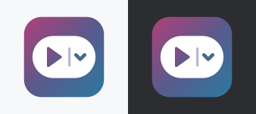
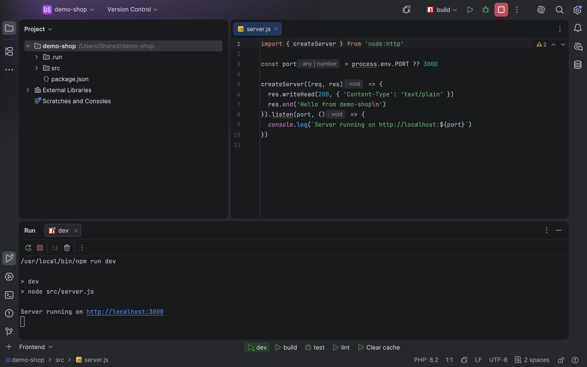
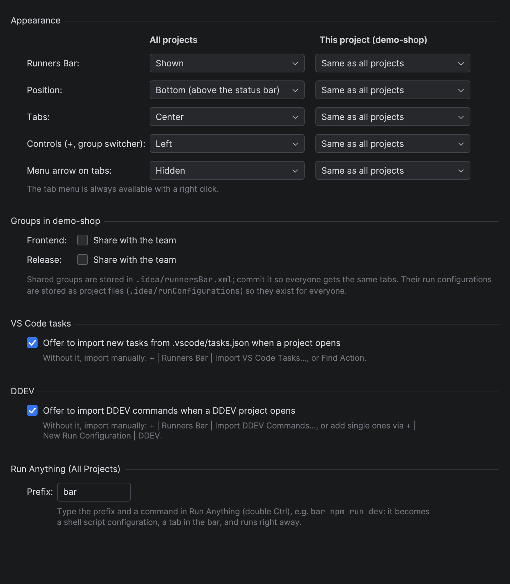

# Runners Bar



Plugin ID `app.heckit.ide.runnersbar` · Vendor heck\it ([heckit.app](https://heckit.app)) · [JetBrains Marketplace](https://plugins.jetbrains.com/plugin/34701-runners-bar) · Source: https://github.com/phse/runners-bar



A plugin for JetBrains IDEs (PhpStorm, IntelliJ IDEA, … 2026.1 and later) that adds a slim bar
with your favourite run configurations above the status bar or below the toolbar.

- **+** adds a run configuration (popup with search). **New Run Configuration** creates a new
  one: pick the type, fill in the editor, and after *OK* it is added to the bar right away.
- **Run Anything** (double Ctrl): `bar npm run dev` (any command after the prefix) asks for a name,
  creates a configuration for the command in the selected directory, adds it to the bar and runs
  it. If another Run Anything provider understands the command (npm scripts, Gradle, Maven, …), its
  own configuration type is used; otherwise a Shell Script configuration that runs in the Run tool
  window. The prefix `bar` can be changed in the settings (one value for all projects). Needs the
  bundled Shell Script plugin.
- **From anywhere**: right-click a place the IDE can run (a script in `package.json`, a test, a
  main method, …) or open the menu of the green run icon in the gutter and choose **Add to Runners
  Bar...**. It asks for a name, creates the configuration if needed and adds it to the current group.
- **VS Code tasks**: if the project (or one of its direct subfolders) has a `.vscode/tasks.json`,
  a notification offers to import the tasks (*Import...*, *Not now*, *Don't offer again*). The
  import dialog lists every task with its command; pick the ones you want. Each folder becomes a
  group, each task a Shell Script configuration that runs in the terminal, in its folder, with its
  `env`. Supported: `shell`, `process`, `npm`, `gulp`, `grunt`, `jake`, `docker-build` and
  `docker-compose` tasks, comments in the file, `${workspaceFolder}`, `${env:…}` and the `osx`/
  `linux`/`windows` variants. Tasks that need VS Code (`${file}`, `${input:…}`, only `dependsOn`,
  extension types such as `docker-run`) are shown greyed out with the reason. Imported
  configurations are personal. Run the import again (+ | Runners Bar | *Import VS Code Tasks...*
  or Find Action) to add the tasks you left out; tasks already imported are updated from the file.
  The notification can be switched off in the settings; it only comes back for new tasks.
- Configurations that Run Anything (or the IDE) created **temporarily** appear in the + menu
  in the *Temporary Configurations* submenu, together with shell commands recently run through
  Run Anything (those become Shell Script configurations). Adding one asks for a name and keeps it
  for good.
- **New Group…** in the + menu creates a group. The **Runners Bar** submenu hides the bar in the current
  project, and switches position (top/bottom), tab alignment (left/center/right) and the side of
  the controls (left/right).
- **Groups**: as soon as there is more than one, a switcher appears next to the +. Use it to
  switch, rename and delete groups. A configuration can be part of several groups. The last
  active group is remembered per project.
- **Move or copy to another group**: *Move to Group* in the tab menu lists the other groups
  (greyed out where the configuration already is) and *New Group…*. Hold **⌥** (macOS) or
  **Ctrl** (Windows, Linux) to copy instead; the entry then reads *Copy to Group*. A
  notification confirms it, with *Undo* and *Switch to Group*.
- **Team groups**: *Share with the Team…* (group switcher or the + menu's **Runners Bar** submenu,
  or a checkbox in the settings) moves a group to `.idea/runnersBar.xml`. Commit that file and
  everyone gets the same tabs, e.g. *Start dev*, *Tests*, *Deploy staging*. Run configurations of a
  shared group that live only in your workspace are stored as project files
  (`.idea/runConfigurations`) so they exist for everyone; the confirmation names them. Shared groups
  appear in their own section of the group switcher and are reloaded when the file changes (e.g.
  after `git pull`). *Stop Sharing…* moves a group back to your workspace.
- **Drag and drop**: drag tabs to reorder them, just like editor tabs: the tab follows the mouse
  and the other tabs make room. Dragged outside the bar, the tab turns red with a trash icon;
  dropping it there removes it from the group. Keep it outside for half a second and a list of
  the other groups appears next to the mouse: drop it on a group to move it there, with **⌥** /
  **Ctrl** to copy it (a green + shows on the tab). Press **Escape** while dragging to cancel.
- **Clicking a tab** starts the configuration right away (run, or debug if switched to debug mode).
- The **arrow** (or a right click) opens the menu:
  - Debug once / run once without the debugger
  - Debug mode (switch the tab to debug permanently)
  - Stop (while it is running)
  - Settings… (the configuration's editor)
  - Rename…
  - Duplicate… (opens the copy's editor; after *OK* it is placed right behind the original)
  - Move to Group / Copy to Group (see above)
  - Shell (Shell Script configurations only): *Execute in the Terminal* and, if a Run Anything
    provider understands the command, convert it to that provider's configuration (runs it)
  - Remove (from the bar) / Delete… (deletes the configuration, after a confirmation)
- Running configurations have a green background and a dot on their icon.
- If a configuration no longer exists, its tab stays with a warning icon until you remove it.
  Renamed configurations are followed.
- Show or hide the bar via **View | Appearance | Runners Bar** (default for all projects).
- Show or hide it in the current project only: **Hide in This Project** in the + menu's
  **Runners Bar** submenu, or **View | Appearance | Runners Bar in This Project**. The project
  setting wins over the default, so a project can also show the bar while it is off by default.
- **Settings | Appearance & Behavior | Runners Bar**: a table with one row per setting: show or
  hide the bar, position *top* (below the toolbar) or *bottom* (above the status bar), tabs *left*,
  *center* or *right*, controls (+, group switcher) *left* or *right*, menu arrow on the tabs shown
  or hidden (the menu is always available with a right click). The first column holds the
  **defaults for all projects**, the second one the current project's value or *Same as all
  projects*. Below the table, every group of the project has a *Share with the team* checkbox,
  and *VS Code tasks* switches the import notification on or off.
  The **Runners Bar** submenu of the + menu changes the current project only; choosing the default
  value there makes the project follow the default again. New tabs are always appended on the right.

Tabs, groups and the per-project visibility are stored per project in `.idea/workspace.xml`, so
they are personal and don't end up in version control, together with the project's own layout
values. Shared groups are the exception: they live in `.idea/runnersBar.xml`. The defaults are IDE
settings (`options/runnersBar.xml`). The UI is available in English and German.



## Installation

In the IDE, go to *Settings | Plugins | Marketplace* and search for **Runners Bar**, or use the
[Marketplace page](https://plugins.jetbrains.com/plugin/34701-runners-bar). Bugs and ideas are
welcome as [GitHub issues](https://github.com/phse/runners-bar/issues).

## Build and run

Gradle needs JDK 17 or later. The toolchain (JDK 25) is downloaded by Gradle via foojay if needed.

```
./gradlew runIde        # start a sandbox IDE with the plugin
./gradlew buildPlugin   # build/distributions/runners-bar-<version>.zip
```

Verify against the local IDE and the oldest supported version (`verifyOldestVersion`):

```
./gradlew verifyPlugin
```

Install a self-built ZIP: *Settings | Plugins | ⚙ | Install Plugin from Disk…*

By default Gradle downloads PhpStorm `platformVersion` (from `gradle.properties`) as the target
platform. With an installed IDE it's faster: create `local.properties` (not checked in) containing
e.g.

```
platformLocalPath=/Applications/PhpStorm.app
```

## Publishing (JetBrains Marketplace)

The Marketplace description lives in `src/main/resources/META-INF/plugin.xml`, the change notes in
`build.gradle.kts`, the icon in `META-INF/pluginIcon.svg` (light theme) and `pluginIcon_dark.svg`
(dark theme). The IDE and the Marketplace read the icon straight from the ZIP, it doesn't have to be
uploaded separately. After changing the icon, regenerate the preview `marketplace/plugin-icon.png`
at the top of this README (command below). Earlier drafts are in `marketplace/icon-proposals/` (the previous
pill icon is `2a-pille-luftig-final`). The current icon fills the whole square like all
heck\it plugins: gradient `#B04079` → `#5A5A8C` → `#2A7AA0` (45°, same in light and dark theme)
with a white pill, the controls inside in the same gradient. Alternatives:
`vollflaechig-linien` (white line symbol without pill) and the inverted `*-invertiert_dark`.

```
T=$(mktemp -d)
rsvg-convert -w 120 src/main/resources/META-INF/pluginIcon.svg -o $T/l.png
rsvg-convert -w 120 src/main/resources/META-INF/pluginIcon_dark.svg -o $T/d.png
magick -size 180x160 xc:'#F7F8FA' $T/l.png -gravity center -composite $T/L.png
magick -size 180x160 xc:'#2B2D30' $T/d.png -gravity center -composite $T/D.png
magick $T/L.png $T/D.png +append marketplace/plugin-icon.png
```

1. Bump the version in `gradle.properties`, add change notes.
2. `./gradlew clean buildPlugin verifyPlugin`
3. Create a token at https://plugins.jetbrains.com/author/me/tokens, then
   `PUBLISH_TOKEN=… ./gradlew publishPlugin`. The token belongs to your JetBrains account, not to a
   vendor, so it can be kept globally in `~/.gradle/gradle.properties` as
   `jetbrainsMarketplaceToken=…`; then `./gradlew publishPlugin` is enough. Alternatively upload the ZIP from
   `build/distributions/` by hand on the
   [Marketplace page](https://plugins.jetbrains.com/plugin/34701-runners-bar). JetBrains reviews
   every version before it is released.
4. Tag the commit (`git tag v<version>`) and push.

Signing is optional (variables `CERTIFICATE_CHAIN`, `PRIVATE_KEY`, `PRIVATE_KEY_PASSWORD`,
see https://plugins.jetbrains.com/docs/intellij/plugin-signing.html).

## Regenerating the screenshots

```
./gradlew runIde -Pscreenshots=marketplace/screenshots
```

Copies `marketplace/demo-project` to `/Users/Shared/demo-shop` (so no user path shows up in the
images), opens it in the sandbox, starts `dev` and writes six PNGs to `marketplace/screenshots/`
(bar, tab menu, groups, add, bar at the top, settings page). The IDE paints its own window for
this, no screen recording permission is needed. The helper lives in `src/screenshot/` and is only compiled with
`-Pscreenshots`, never into a release.

Requirements: Node at `/usr/local/bin/node` (hard-coded in the demo run configurations) and
`/Users/Shared/demo-shop` as a trusted project in the sandbox. If the sandbox asks on the first
run, confirm "Trust Project" once and run the command again.

## How it works

There is no official extension point for the area above the status bar or below the toolbar. The
plugin therefore wraps a part of the frame in its own container with the bar on top: the status bar
(position *bottom*) or the central area with editor and tool windows (position *top*). If the IDE
re-inserts that part (e.g. in presentation mode), the bar attaches itself again automatically. When
the plugin is unloaded, the original state is restored.

| File | Contents |
| --- | --- |
| `RunnersBarInstaller.kt` | Startup activity, attaching above the status bar, visibility |
| `RunnersBarService.kt` | Project service, persistence, entries; `RunnersBarSharedService` for shared groups (`.idea/runnersBar.xml`) |
| `RunnersBarState.kt` | Persisted state (personal and shared groups, entries, per-project values) |
| `RunnersBarPanel.kt` | The bar, the "+" popup with its submenus, and drag and drop |
| `RunnersBarTab.kt` | Tab with click-to-run and menu |
| `AddToRunnersBarAction.kt` | *Add to Runners Bar...* in the context menu and the gutter run icon's menu |
| `VsCodeTasks.kt` | Reads `.vscode/tasks.json` (JSON with comments) and translates tasks into commands |
| `VsCodeTasksImport.kt` | Import dialog, notification on project open, *Import VS Code Tasks...* action |
| `RunnersBarExecution.kt` | Starting (run/debug) and detecting running processes |
| `RunnersBarSettings.kt` | Defaults (position, tab and control alignment, menu arrow) and the settings page with per-project overrides |
| `ToggleRunnersBarAction.kt` | Toggles in *View \| Appearance* (global and per project) |
| `RunnersBarBundle.kt` | UI texts (English, German) in `resources/messages/` |

## License

Apache License 2.0, see [`LICENSE`](LICENSE) and [`NOTICE`](NOTICE).
Copyright 2026 Peter Heck (heck\it). The name and logo are not covered by the license.
